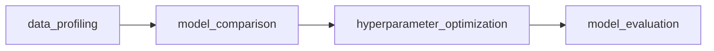

# 🧠 Student Mental Health Risk Prediction

[](https://www.python.org/)
[](https://scikit-learn.org/)
[](https://airflow.apache.org/)
[](https://streamlit.io/)
[](https://www.docker.com/)
[](LICENSE)

> **⚠️ AVERTISSEMENT ÉTHIQUE & PÉDAGOGIQUE (STRICT DISCLAIMER)**  
> Ce projet s'inscrit dans un cadre **strictement pédagogique et préventif**. Les modèles développés et les prédictions générées **ne constituent en aucun cas un diagnostic médical ou psychiatrique**, un outil de dépistage clinique, ni un dispositif d'évaluation disciplinaire ou de sélection académique. L'objectif exclusif est d'aider les équipes pédagogiques et d'accompagnement à mieux comprendre les facteurs de stress et à orienter préventivement les étudiants vers les services de santé et de tutorat compétents.

---

## 📌 Sommaire
1. [Contexte & Objectifs Métier](#-contexte--objectifs-métier)
2. [Structure du Projet](#-structure-du-projet)
3. [Jeu de Données (Dataset)](#-jeu-de-données-dataset)
4. [Démarche Méthodologique & Pipeline Data Science](#-démarche-méthodologique--pipeline-data-science)
5. [Résultats, Comparaisons & Évaluation](#-résultats-comparaisons--évaluation)
6. [Analyse des Erreurs & Limites Métier](#-analyse-des-erreurs--limites-métier)
7. [Orchestration de Pipeline avec Apache Airflow](#-orchestration-de-pipeline-avec-apache-airflow)
8. [Application Interactive Streamlit](#-application-interactive-streamlit)
9. [Installation & Guide d'Exécution](#-installation--guide-dexécution)
10. [Livrables & Liens du Projet](#-livrables--liens-du-projet)

---

## 🎯 Contexte & Objectifs Métier

Dans l'enseignement supérieur, le bien-être psychologique des apprenants est un facteur déterminant de leur réussite académique et de leur épanouissement personnel. Un établissement d'enseignement souhaite identifier de manière proactive les signaux faibles et facteurs de risque associés à la détresse psychologique afin de déclencher des mesures d'accompagnement personnalisées.

### Objectifs Clés
- **Détection Précoce des Risques :** Classifier le niveau de risque de santé mentale d'un étudiant (`Low`, `Medium`, `High`).
- **Compréhension des Facteurs :** Quantifier l'impact du sommeil, du stress financier, du temps d'écran et du soutien familial.
- **Accompagnement Ciblé :** Orienter les étudiants vulnérables vers les cellules d'écoute et tuteurs académiques.
- **Industrialisation & Reproductibilité :** Automatiser le cycle de vie du modèle via un DAG Airflow et offrir une interface d'inférence en temps réel via Streamlit.

---

## 📂 Structure du Projet

Le projet respecte une architecture modulaire, professionnelle et découplée pour garantir la maintenabilité, la reproductibilité et la conformité MLOps :

```bash
Student Mental Health Prediction Project/
├── .gitignore                          # Fichiers et dossiers exclus du suivi Git
├── Dockerfile                          # Image Docker personnalisée pour Airflow & dépendances
├── docker-compose.yml                  # Stack Airflow orchestrée en conteneurs
├── README.md                           # Documentation complète et guide de référence
├── requirements.txt                    # Dépendances Python versionnées
│
├── airflow/                            # Fichiers de configuration et journaux locaux Airflow
│   └── logs/                           # Logs d'exécution des tâches du DAG
│
├── app/                                # Application Web interactive Streamlit
│   ├── Home.py                         # Page d'accueil et présentation du projet
│   └── pages/
│       ├── 1_Model_Performance.py      # Consultation des métriques, matrice et rapports
│       └── 2_Prediction.py             # Formulaire d'inférence et calcul de probabilités
│
├── dags/                               # Définition des workflows programmés Airflow
│   └── mental_health_pipeline_dag.py   # DAG orchestrant le profiling, benchmark, tuning et test
│
├── data/
│   └── raw/
│       └── student_mental_health.csv   # Données brutes de l'enquête étudiante
│
├── models/
│   └── best_model_pipeline.joblib      # Pipeline sérialisé complet (Preprocessing + SVM optimisé)
│
├── notebooks/
│   └── eda/
│       └── exploratory_data_analysis.ipynb # Notebook documenté de l'audit et de l'EDA
│
├── reports/                            # Artefacts, tableaux de résultats et visualisations
│   ├── model_comparison/
│   │   └── comparison_results.csv      # Résultats de la validation croisée (5-fold)
│   ├── model_optimization/
│   │   └── optimization_results.csv    # Résultats de l'optimisation GridSearchCV
│   └── model_evaluation/
│       ├── classification_report.csv   # Rapport par classe (Précision, Rappel, F1)
│       ├── confusion_matrix.png        # Heatmap de la matrice de confusion finale
│       ├── evaluation_metrics.csv      # Métriques globales sur le jeu de test
│       └── misclassified_samples.csv   # Analyse détaillée des 96 cas d'erreurs de test
│
└── src/                                # Code source Python structuré en modules
    ├── data/
    │   ├── data_loader.py              # Chargement robuste et validation d'intégrité CSV
    │   └── data_profiling.py           # Audit qualité, statistiques, plages et corrélations
    ├── preprocessing/
    │   └── data_preprocessing.py       # Split train/test (80/20) et ColumnTransformer scikit-learn
    ├── training/
    │   ├── model_training.py           # Entraînement des modèles de base (LR, RF, SVM)
    │   ├── model_comparison.py         # Benchmark sous validation croisée stratifiée
    │   └── hyperparameter_optimization.py # Réglage fin des hyperparamètres (GridSearchCV)
    └── evaluation/
        └── model_evaluation.py         # Évaluation finale sur test set, matrice et rapport d'erreurs
```

---

## 📊 Jeu de Données (Dataset)

Le jeu de données comprend **2 000 enregistrements** (1 903 observations complètes/valides) et **17 colonnes** décrivant le profil académique, hygiéno-diététique, financier et psychologique des étudiants :

| Variable | Type | Description / Plage autorisée | Rôle |
|---|---|---|---|
| `Student_ID` | Identifiant | Format `STUxxxx` | Identifiant unique (exclu de l'entraînement) |
| `Age` | Numérique | 18 à 30 ans | Âge de l'apprenant |
| `Gender` | Catégoriel | `Male`, `Female` | Genre déclaré |
| `Year_of_Study` | Numérique | 1 à 5 | Année d'études universitaires |
| `Sleep_Hours` | Numérique | 4.0 à 10.0 h/nuit | Moyenne d'heures de sommeil |
| `Study_Hours_Per_Week` | Numérique | Heures hebdomadaires d'étude | Charge de travail académique |
| `GPA` | Numérique | 0.0 à 4.0 (ou base 20 normalisée) | Moyenne générale académique |
| `Social_Media_Hours` | Numérique | Heures quotidiennes | Usage des réseaux sociaux |
| `Screen_Time_Hours` | Numérique | Heures quotidiennes d'écran | Exposition numérique globale |
| `Physical_Activity` | Ordinal | `Low`, `Moderate`, `High` | Niveau d'activité physique |
| `Financial_Stress` | Numérique | Échelle 1 (Faible) à 10 (Élevé) | Pression financière ressentie |
| `Family_Support` | Numérique | Échelle 1 (Faible) à 10 (Élevé) | Niveau de soutien de l'entourage |
| `Attendance_Rate` | Numérique | 0 à 100 % | Taux d'assiduité aux cours |
| `Part_Time_Job` | Binaire | `Yes`, `No` | Activité salariée en parallèle |
| `Diet_Quality` | Ordinal | `Poor`, `Average`, `Good` | Qualité de l'alimentation |
| `Previous_Mental_Health_History` | Binaire | `Yes`, `No` | Antécédents de troubles anxio-dépressifs |
| **`Mental_Health_Risk`** | **Cible (Target)** | **`Low` (33.3%), `Medium` (33.3%), `High` (33.3%)** | **Niveau de risque de santé mentale** |

---

## 🔬 Démarche Méthodologique & Pipeline Data Science

### 1. Audit Qualité & EDA
- **Contrôles d'intégrité :** Détection des valeurs manquantes, contrôle des doublons (aucun doublon identifié sur `Student_ID`), vérification des bornes numériques logiques.
- **Équilibre des Classes :** La variable cible est remarquablement équilibrée (~33% par classe). L'application de sur-échantillonnage de type SMOTE n'est donc pas requise et risquerait d'introduire du bruit synthétique dans les zones frontières.
- **Corrélations & Facteurs Clés :**
  - Forte corrélation négative entre `Sleep_Hours` et le risque élevé.
  - Forte corrélation positive entre `Financial_Stress` et le risque de détresse psychologique.
  - Le soutien familial (`Family_Support`) et la qualité de la diète agissent comme des facteurs protecteurs majeurs.

### 2. Prévention du Data Leakage & Preprocessing
Afin de proscrire tout risque de fuite d'information (*data leakage*) :
- Le découpage **Train/Test (80% / 20%)** est effectué en amont avec **stratification** sur la variable cible (`stratify=y`, `random_state=42`).
- Toutes les imputations et mises à l'échelle sont intégrées dans un `ColumnTransformer` scikit-learn entraîné exclusivement sur le jeu d'entraînement :
  - **Variables numériques :** `SimpleImputer(strategy='median')` pour la robustesse aux valeurs aberrantes + `StandardScaler()`.
  - **Variables binaires (`Part_Time_Job`, `Previous_Mental_Health_History`) :** `OrdinalEncoder(categories=[['No', 'Yes']])`.
  - **Variables ordinales (`Physical_Activity`, `Diet_Quality`) :** `OrdinalEncoder(categories=[['Low', 'Moderate', 'High'], ['Poor', 'Average', 'Good']])`.
  - **Variables nominales (`Gender`) :** `OneHotEncoder(handle_unknown='ignore')`.

---

## 📈 Résultats, Comparaisons & Évaluation

### 1. Comparaison Préliminaire (Validation Croisée 5-Fold sur Train)
Trois familles d'algorithmes ont été comparées selon le protocole de validation croisée stratifiée :

| Modèle | Accuracy Moyenne | Précision Moyenne | Rappel Moyen | F1-Score Moyen | ROC-AUC (OVR) |
|---|---|---|---|---|---|
| **Logistic Regression** | 74.64% ± 2.64% | 74.85% ± 2.85% | 74.64% ± 2.64% | **74.65% ± 2.72%** | **0.9089 ± 0.0107** |
| **SVM (Kernel RBF/Linear)** | 72.08% ± 0.97% | 72.60% ± 0.91% | 72.08% ± 0.97% | **72.25% ± 0.94%** | **0.8894 ± 0.0051** |
| **Random Forest** | 67.34% ± 1.84% | 67.03% ± 1.82% | 67.34% ± 1.84% | **67.06% ± 1.77%** | **0.8516 ± 0.0142** |

### 2. Optimisation des Hyperparamètres (GridSearchCV)
Après exploration exhaustive des grilles d'hyperparamètres avec scoring `f1_weighted` :
- **SVM Optimisé (Sélectionné) :** Kernel `linear`, $C=0.1$, `gamma='scale'`. **F1-Score CV : 75.46%**.
- **Régression Logistique :** $C=10$, pénalité L2. **F1-Score CV : 74.94%**.
- **Random Forest :** `n_estimators=300`, `max_depth=10`, `min_samples_split=5`. **F1-Score CV : 68.57%**.

> **Justification du choix du SVM :**  
> Le classifieur SVM à noyau linéaire ($C=0.1$) régularise efficacement l'espace multidimensionnel, élimine le surapprentissage observé sur les arbres de décision et maximise la marge de séparation tout en offrant une excellente stabilité (écart-type le plus faible en validation croisée).

### 3. Performance Finale sur le Jeu de Test Indépendant (20%, $N=381$)

| Métrique Globale | Score Obtenu |
|---|---|
| **Accuracy** | **74.80%** |
| **Weighted Precision** | **75.62%** |
| **Weighted Recall** | **74.80%** |
| **Weighted F1-Score** | **75.09%** |
| **ROC-AUC (One-vs-Rest)** | **0.9048** |

#### Rapport de Classification par Niveau de Risque
| Classe | Précision | Rappel | F1-Score | Support |
|---|---|---|---|---|
| **High** (Priorité Prévention) | **84.13%** | **81.54%** | **0.8281** | 130 |
| **Low** (Profil Serein) | **81.42%** | **74.19%** | **0.7764** | 124 |
| **Medium** (Zone Pivot) | **61.27%** | **68.50%** | **0.6468** | 127 |
| **Moyenne Pondérée** | **75.62%** | **74.80%** | **0.7509** | 381 |

---

## 🔍 Analyse des Erreurs & Limites Métier

L'extraction systématique des 96 prédictions erronées sur le jeu de test révèle des caractéristiques cruciales pour la mise en œuvre terrain :

1. **Très Faible Risque de Faux Négatif Critique :**
   - Seul **1 cas sur 130** étudiants à risque `High` a été prédit comme `Low`.
   - Cela garantit que la quasi-totalité des étudiants en situation de détresse sévère est correctement captée soit en `High`, soit en `Medium`.
2. **Ambiguïté de la Classe Intermédiaire (`Medium`) :**
   - 32 étudiants `Low` ont été classés `Medium`, et 23 étudiants `High` ont été classés `Medium`.
   - La classe `Medium` joue un rôle de zone tampon où se regroupent des profils hybrides (ex. bon sommeil mais stress financier élevé).
3. **Limites Inhérentes au Projet :**
   - Données déclaratives sujettes au biais de désirabilité sociale.
   - Absence de suivi temporel longitudinal (mesures transversales à un instant $t$).
   - Nécessité impérative d'un entretien humain avant toute action concrète d'aide.

---

## 🔄 Orchestration de Pipeline avec Apache Airflow

Le workflow d'entraînement et de gouvernance du modèle est entièrement automatisé à l'aide d'un DAG Airflow (`student_mental_health_pipeline`) planifié de façon récurrente (`@daily`) :



- **`data_profiling` :** Audit automatique de l'intégrité du dataset, validation des plages et détection d'anomalies.
- **`model_comparison` :** Entraînement et benchmark 5-fold de Logistic Regression, SVM et Random Forest.
- **`hyperparameter_optimization` :** Recherche sur grille (GridSearch), sélection du meilleur modèle et sérialisation dans `models/best_model_pipeline.joblib`.
- **`model_evaluation` :** Test sur données inédites, génération des métriques CSV, de la matrice de confusion PNG et du journal d'erreurs.

---

## 💻 Application Interactive Streamlit

L'application Streamlit fournit une interface claire, intuitive et sécurisée pour les utilisateurs non-techniciens et les conseillers d'orientation :

1. **Page d'Accueil (`Home.py`) :** Présentation générale, charte éthique et avertissements d'usage.
2. **Performances du Modèle (`1_Model_Performance.py`) :** Visualisation des KPI (Accuracy, Precision, Recall, F1, ROC-AUC), du tableau de classification complet et de la heatmap de confusion.
3. **Module de Prédiction (`2_Prediction.py`) :** Formulaire dynamique permettant de saisir les caractéristiques d'un étudiant et d'obtenir en temps réel :
   - Le niveau de risque prédit (`High`, `Medium`, `Low`).
   - La distribution complète des probabilités associées (ex. High: 78.4%, Medium: 16.2%, Low: 5.4%).

---

## ⚙️ Installation & Guide d'Exécution

### Prérequis
- Python 3.10 ou supérieur
- Git
- Docker & Docker Compose (optionnel, pour faire tourner Airflow)

### 1. Clonage du Répertoire
```bash
git clone https://github.com/BOUCHAIB-EL-HAIDI/Croise1_Student-Mental-Health-Prediction.git
cd "Croise1_Student-Mental-Health-Prediction"
```

### 2. Configuration de l'Environnement Virtuel
```bash
# Création du venv
python -m venv .venv

# Activation sous Windows (PowerShell)
.\.venv\Scripts\Activate.ps1

# Activation sous Linux / macOS
source .venv/bin/activate

# Installation des dépendances requises
pip install -r requirements.txt
```

### 3. Exécution des Modules en Ligne de Commande
```bash
# 1. Audit et Profiling des données
python src/data/data_profiling.py

# 2. Entraînement et benchmark des modèles
python src/training/model_comparison.py

# 3. Optimisation des hyperparamètres & sauvegarde du pipeline
python src/training/hyperparameter_optimization.py

# 4. Évaluation finale sur test set & génération des rapports
python src/evaluation/model_evaluation.py
```

### 4. Lancement de l'Application Streamlit
```bash
streamlit run app/Home.py
```
*L'application s'ouvre automatiquement dans votre navigateur à l'adresse `http://localhost:8501`.*

### 5. Lancement de la Stack Airflow via Docker
```bash
# Démarrage du conteneur Airflow en mode autonome
docker compose up -d

# Accès à l'interface web Airflow
# URL : http://localhost:8080
# Identifiants par défaut : airflow / airflow (ou créés au premier lancement)
```

---

## 📋 Livrables & Liens du Projet

- **Code Source GitHub :** [Dépôt Officiel GitHub](https://github.com/BOUCHAIB-EL-HAIDI/Croise1_Student-Mental-Health-Prediction.git)
- **Gestion de Projet Jira :** [Tableau Jira SMHP](https://bouchaibelhaidi96.atlassian.net/jira/software/projects/SMHP/boards/69?filter=&groupBy=none&atlOrigin=eyJpIjoiYWMxMTAzMzYyM2QzNDU4OGE1MGE3NWZkYjg0M2E4OWEiLCJwIjoiaiJ9)
- **Support de Présentation :** [Présentation Canva](https://canva.link/95xf7ykrbgry9c4)

---

## 👨‍💻 Auteur & Cadre Académique
- **Auteur :** Bouchaib El Haidi
- **Formation / Brief :** Prédiction du risque de santé mentale chez les étudiants

